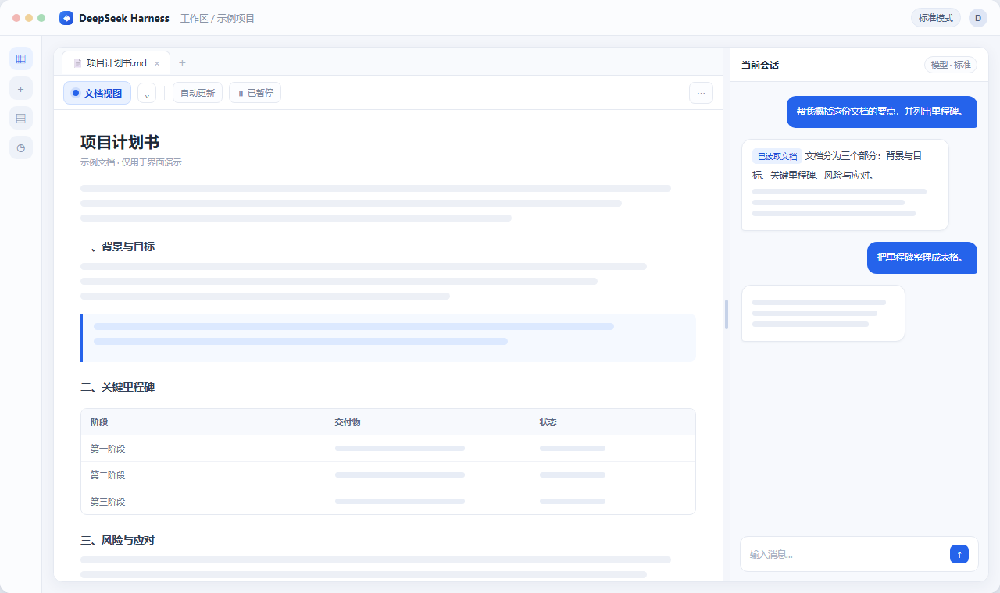
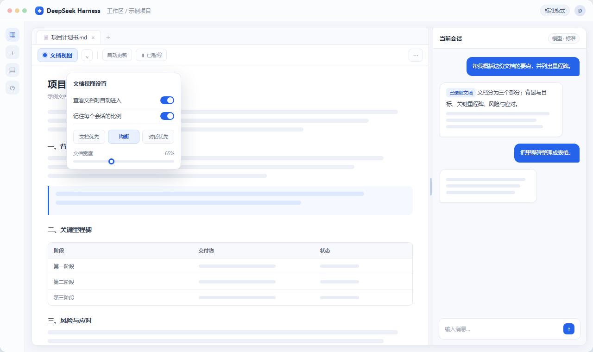
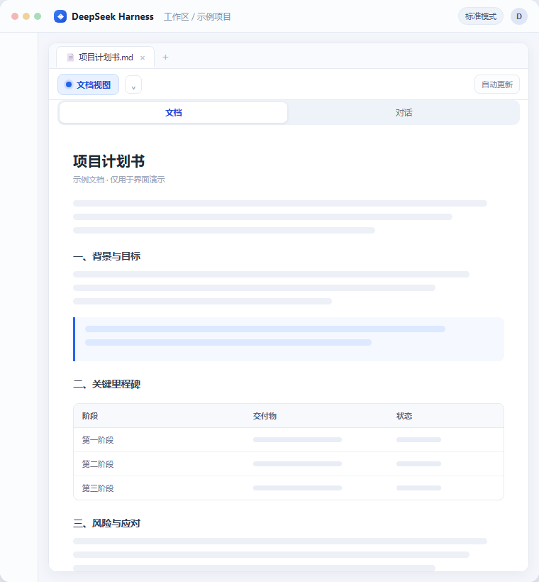

# dsh-document-view

**Read your document and talk to your AI at the same time.** A split document view for [DeepSeek Harness](https://github.com/deepseek-ai/DeepSeek-Harness): the document stays in the center, the current conversation stays on the right — no more tab hopping.

[](LICENSE)
[](https://github.com/Frank-Fan-1058/dsh-document-view/releases)
[](https://github.com/deepseek-ai/DeepSeek-Harness/releases/tag/dsh-v0.2.2-rc.3)



> Screenshots are **desensitized illustrations** with generic placeholder content. They contain no real sessions, file names, accounts, or personal data.

[中文说明 →](README.md) · [Marketplace submission guide →](docs/PUBLISHING.md) · [Compatibility & security →](docs/COMPATIBILITY.md)

---

## The problem

Open a file in DSH and it takes over the right sidebar, pushing your conversation away. Asking the AI to explain, summarize or rewrite against that document means constantly switching between "reading" and "chatting" — and losing context every time.

`dsh-document-view` does exactly one thing: **keeps both on screen**. It does not take over the editor, change save behavior, or touch your files. It only rearranges the window so DSH's native document / Office preview and the chat panel work side by side.

| | Default | Document view on |
| --- | --- | --- |
| Document | Takes the right sidebar | Center area |
| Conversation | Pushed away | Always visible on the right |
| Ask AI about the document | Switch back and forth | Same screen |
| Editing / saving / preview | Native | **Still native** |

## Features

### 1. Document and chat, side by side


Open any file, then click **Document view** in the conversation header actions or the file tab actions. Drag the divider to resize; `←` / `→` nudge it, `Home` resets the ratio, and double-clicking the divider restores the default. The toggle and ratio are **saved per session**.

### 2. Settings and auto-enter



The arrow next to the toggle opens settings:

- **Auto-enter on document view** (off by default) — fires only when *you* click a file or file tab; background file operations never open it. After you exit manually, the same file won't re-open repeatedly.
- **Document-first / Balanced / Chat-first** presets, saved per session.
- **Auto update / Paused** — reuses the host's native file watcher. Pause when you want to read carefully; resuming shows the latest content while preserving the native viewer's page and zoom state.

### 3. Works in narrow windows



When the window is too narrow it switches to a single-column **Document / Chat** toggle. **Unsent input is preserved**, and focus moves to the visible switch if the current focus would be hidden.

### 4. Native all the way down

Rendering, editing, saving and preview of Markdown, PDF, Word, Excel and PowerPoint remain entirely with DSH's own viewers and Office engine. The plugin **never reads, writes or uploads your files** and reimplements no editing feature. Disable it and the default layout returns.

## Privacy & security

- **No network calls** — no `fetch`, `XMLHttpRequest`, `WebSocket`, no external URLs in the code.
- **No file access** — no filesystem or editor read/write APIs.
- **No credentials** — no API keys, tokens, passwords, cookies, `.env` or config files ship in the package.
- **One preference only** — browser `localStorage` holds the auto-enter toggle and per-session ratios under `dsh.document-view.v1`; no document content, paths, file names or chat content.
- **Narrow CSS scope** — all styles are scoped to the plugin's own `[data-fdc-*]` attributes. No host components are moved, cloned or remounted; only the window grid geometry changes.

See [SECURITY.md](SECURITY.md) and [docs/COMPATIBILITY.md](docs/COMPATIBILITY.md).

## Requirements

- [DeepSeek Harness](https://github.com/deepseek-ai/DeepSeek-Harness) Desktop / Web, verified on **v0.2.2-rc.3** (the current official release).
- Node.js >= 20 — **only for rebuilding from source**; not needed to install or use.
- No `engines.dsh` hard constraint: a wrong constraint blocks installation outright, so compatibility is documented instead.

> The plugin relies on the host's DOM structure and slot names. If a DSH upgrade changes them, the plugin **disables itself safely and the page keeps working** (no white screen). Re-verify with the [upgrade checklist](docs/COMPATIBILITY.md).

## Install

**Option 1 — local directory (easiest)**

```sh
git clone https://github.com/Frank-Fan-1058/dsh-document-view.git
```

Then in DSH: **Plugins → Add plugin**, pick the `dsh-document-view` directory, enable it, and refresh the page (or restart DSH).

**Option 2 — tarball**

```sh
npm pack
```

Extract `dsh-document-view-1.1.0.tgz` anywhere, then point step 2 of Option 1 at that directory.

**Option 3 — build from source**

```sh
node scripts/build.mjs
```

`src/` is the source; `client.js` is the self-contained build artifact (all CSS inlined, no runtime dependencies). **Rebuild `client.js` after any `src/` change** — don't hand-edit the artifact.

> `file:` dependencies are physical copies: after editing source, remove `node_modules/<package>` and reinstall so the running copy updates.

## Usage

1. Open a file in the right sidebar (Markdown / PDF / Office).
2. Click **Document view** in the conversation header or file tab actions.
3. Drag the divider; `←` / `→` to nudge, `Home` or double-click to reset.
4. Open settings via the arrow for auto-enter and layout presets.
5. Click the toggle again (or the exit entry in the session / file header) to return to the default layout.

## FAQ

**Will it affect my editors or Office plugins?** No. It changes layout only — Univer, Office converters and native editors are untouched.

**Are my files read or uploaded?** No. No network requests, no file I/O, only the toggle and ratios are stored.

**Does anything remain after disabling?** No. All injected styles, attributes, the divider and listeners are removed on teardown.

**What if a DSH upgrade breaks it?** It disables itself safely and the page stays usable. Open an [Issue](https://github.com/Frank-Fan-1058/dsh-document-view/issues) with your DSH version.

**Which file types are supported?** Whatever the host supports natively — Markdown, PDF, Word, Excel, PowerPoint, etc. The plugin adds no format restrictions.

## Get listed in plugin marketplaces

See **[docs/PUBLISHING.md](docs/PUBLISHING.md)** for the full playbook (1024 Store, dsh-market, the `dsh-plugin` GitHub topic, npm publishing, and a ready-to-use [catalog entry](docs/awesome-dsh-catalog-entry.json)).

## Contributing

Issues and PRs welcome. Rebuild `client.js` when changing `src/`; update both `locale/en.json` and `locale/zh.json` when changing UI copy. Never put real sessions, file names, accounts or personal data into illustrations or examples.

## License

[MIT](LICENSE) © 2026 dsh-document-view contributors
