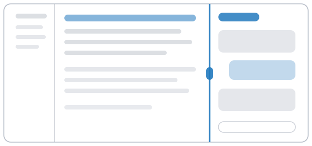

# dsh-document-view

给 DeepSeek Harness 用的第三方插件：打开文件时**文档居中**，当前会话**留在右侧**，边看文档边聊。



> 从一个本机自用的文档协作插件抽出，重新命名、补齐 DSH 展示元数据与开源许可后发布。功能代码与已稳定运行版本一致，仅改了标识符与本地存储键。

## 功能

- 中间看文档、右侧保留对话；拖动分隔线调宽度，左右方向键微调、Home 复位。
- 会话头部 / 文件标签上的「文档视图」开关；旁边箭头进设置，可选「查看文档时自动进入」（默认关）。
- 窄窗口在「文档 / 对话」间切换，未发送的输入不丢。
- 开关与比例按会话保存。
- **只改布局**：编辑、保存、预览继续用 DSH 原生文档 / Office 查看器，插件不读写你的文件。

## 要求

- DeepSeek Harness 桌面版（已在 `0.2.2-rc.3` 验证）
- Node.js >= 20（仅从源码重建时需要）

## 安装（第三方）

**方式一：本地目录安装（推荐）**

1. `git clone https://github.com/Frank-Fan-1058/dsh-document-view.git`
2. 打开 DSH → **插件 → 添加插件**，选中刚 clone 出来的 `dsh-document-view` 目录。
3. 在插件列表启用 `dsh-document-view`，刷新网页（或重启 DSH）后生效。

**方式二：打成 tarball**

```sh
npm pack
```

把生成的 `dsh-document-view-1.0.0.tgz` 解压到任意目录，再按方式一第 2 步指向该目录。

> `file:` 依赖是实体拷贝：改了源码要删掉 `node_modules/<包名>` 再重装，运行副本才会更新。

## 从源码重建

```sh
node scripts/build.mjs
```

`src/` 是源码，`client.js` 是构建产物（自包含，内联全部 CSS，无运行时依赖）。**改 `src/` 后必须重建**并核对 `client.js`；不要手改 `client.js`。

## 兼容性 / 限制

- 依赖宿主 DOM 结构与 slot 名称，DSH 升级后可能需要重新验证。
- 不修改 Univer、Office 转换服务或任何原生编辑器。
- 停用插件即恢复默认布局。
- 完整口径见 `locale/en.json` / `locale/zh.json` 的 `meta.description`。

## 发布状态

v1.0.0 已发布到 https://github.com/Frank-Fan-1058/dsh-document-view （`main` 分支 + `v1.0.0` tag 均已推送）。后续升级只需本地提交、打新 tag、`git push origin main && git push origin <新tag>`，再到 **Releases → Draft a new release** 选该 tag 发布。

## 许可证

MIT
